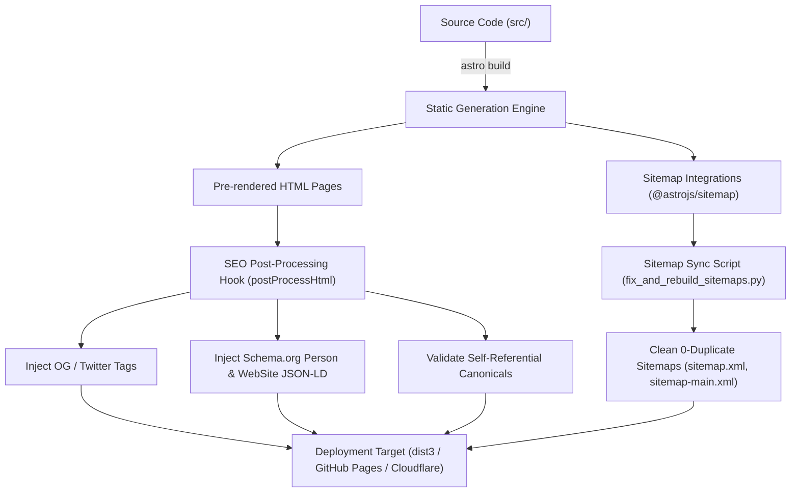

# Architecture Documentation

## 1. Core Architecture & Tech Stack

The application is built using a high-performance static site generator (SSG) architecture designed for zero server latency, maximum security, and search engine optimization.

* **Core Framework:** Astro 7.3.3 (Node.js ≥ 22.12.0)
* **Rendering Paradigm:** Static HTML pre-rendering (`SSG`) for every route, with a hybrid caveat: on the routes listed in `src/utils/spaNavGuard.mjs`, a prebuilt React bundle mounts with `createRoot(#root).render()`. That call *replaces* `#root`'s children rather than hydrating them, so Astro-rendered content inside `#root` does not survive the mount. Anything that must persist on those routes is rendered as a sibling of `#root`.
* **Client-side Reactivity:** Vanilla JavaScript modules (`public/nav-normalize.js`, `public/ad-place.js`) plus a prebuilt React 19 bundle (`assets/index-Ctp2HkQJ.js`) whose source is not kept in this repository.
* **Styling System:** Vanilla CSS design tokens with custom HSL color palettes, responsive flexbox/grid containers, and mobile drawer navigation.

---

## 2. Directory & Component Architecture

```
weight-loss-calculator/
├── public/                       # Static public assets (favicons, sitemaps, robots.txt)
│   ├── ad-place.js               # AdSense anchor placement for bundle-rendered routes
│   └── nav-normalize.js          # Post-mount navigation/title repairs
├── calculators/, blog/, ...      # Committed static HTML trees copied over the Astro output
├── src/
│   ├── components/               # Reusable UI Components
│   │   ├── AdBanner.astro        # Responsive AdSense unit (rendered outside #root)
│   │   ├── Header.astro          # Universal navigation header
│   │   ├── Footer.astro          # Site-wide E-E-A-T footer
│   │   ├── SEO.astro             # Meta, hreflang, schema, ad loader
│   │   └── RelatedCalculators.astro
│   ├── layouts/
│   │   └── BaseLayout.astro      # Master layout with SEO & Schema injection
│   ├── pages/                    # Astro routes & SSG page definitions
│   └── utils/
│       └── spaNavGuard.mjs       # SPA_ROUTES list and navigation guard
├── astro.config.mjs              # Astro configuration, copy-assets & build hooks
├── scripts/prune-noindex.mjs     # Thin-locale pruning for the Cloudflare file limit
└── package.json                  # Node.js dependencies and script entries
```

Note on routing: `src/pages/[...fallback].astro` returns a single dummy path in
production builds, because the `copy-assets` build hook copies the committed static
HTML trees over Astro's render. The committed file is what is served for almost every
route; Astro's own layout output is authoritative only for `/`.

---

## 3. Build & Deployment Lifecycle



---

## 4. SPA Navigation Guard (`spaNavGuard.mjs`)

To prevent client-side routing errors when navigating between static pages and client-hydrated React calculator components, an inline SPA navigation guard is injected before `</body>`. If a client router attempts to load a non-existent SPA chunk, the guard seamlessly fallbacks to standard native browser HTTP navigation.

---

## 5. Sitemap & SEO Subsystem

* **Index Structure:** `sitemap-index.xml` acts as the root index referencing 6 modular sub-sitemaps (`sitemap-main.xml`, `sitemap-calculators.xml`, `sitemap-restaurants.xml`, `sitemap-compare.xml`, `sitemap-categories.xml`, `sitemap-international.xml`).
* **Sitemap Cleanliness:** Automated script `fix_and_rebuild_sitemaps.py` guarantees 0 duplicate `<loc>` tags across index and sub-sitemaps.
* **XSL Rendering:** Custom `sitemap.xsl` transforms raw XML sitemaps into clean, human-readable HTML tables in all browsers.
